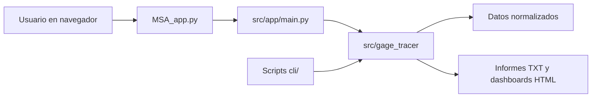

# Integrated MSA Suite

Data Tracer delivers Measurement System Analysis (MSA) workflows for Type 1 Gage Study, Paired T-Test, and crossed Gage R&R ANOVA evaluations. Each workflow supports raw input, structured data, text reports, and self-contained HTML dashboards.

## Repository Overview

- `MSA_app.py` — Canonical Streamlit launcher for interactive MSA workflows.
- `cli/command.py` — Unified `msa` CLI with `type1`, `grr`, and `paired` subcommands.
- `cli/Type_1_gage_handy_tool.py`, `cli/Paired_T_Test_tool.py`,
  `cli/Gage_RR_tool.py` — Legacy entry points retained for compatibility.
- `src/app/` — Streamlit application package with its workflow views and shared components.
- `src/gage_tracer/` — Core library with parsing, calculation, and dashboard rendering.
- `data/examples/` — Versioned synthetic example inputs.
- `data/private/` — Ignored location for confidential local input data.
- `outputs/` — Ignored generated analysis files.
- `tests/` — Validation tests for key analytical components.

## Instalación y ejecución

Instala el paquete en modo editable desde la raíz del repositorio:

```powershell
python -m pip install -e .
```

Inicia la interfaz Streamlit con `streamlit run MSA_app.py` o con el
entry point instalado `msa-app`. La CLI unificada se instala como `msa`:

```powershell
msa type1 --input data/private/type1-study.txt --output outputs/type1
msa grr --input data/private/grr-study.txt --report-order operator-major --output outputs/gage_rr
msa paired --system-a data/private/system-a.txt --system-b data/private/system-b.txt --output outputs/paired
```

Los argumentos de entrada y salida son opcionales: por defecto se usan los
ejemplos bajo `data/examples/` y las carpetas correspondientes bajo `outputs/`.

## Core del proyecto: `src`, `cli` y Streamlit

El proyecto separa la interfaz, las reglas de análisis y los puntos de entrada.
La carpeta `src/gage_tracer/` contiene el núcleo reutilizable; `src/app/` y
los scripts de `cli/` coordinan ese núcleo para la interfaz web o para la
generación de archivos.



### Entrada de Streamlit

- `MSA_app.py` es el lanzador principal documentado. Importa `main`
	desde `src/app`, por lo que funciona directamente desde un checkout del
	repositorio sin requerir una instalación editable; no contiene cálculos
	estadísticos ni define páginas.
- `src/app/main.py` orquesta la navegación y las tres vistas. El paquete separa
	`views/type1_view.py`, `views/paired_view.py` y `views/grr_view.py`; los
	componentes compartidos están en `components/`.
- `src/app/theme.py` inyecta los estilos definidos en `src/app/assets/styles.css`.
	Las vistas delegan parsers y cálculos en `gage_tracer`.
- `cli/app.py` inicia la misma aplicación Streamlit empaquetada. No es uno de
	los tres CLI heredados que generan informes estadísticos.

### Módulos de `src/gage_tracer/`

- `data_parser.py` lee los formatos de entrada y los convierte en tablas
	normalizadas. Contiene parsers distintos para Type 1, Gage R&R y los dos
	formatos del Paired T-Test; valida bloques, etiquetas y mediciones antes de
	que los análisis reciban los datos.
- `calculations.py` contiene los cálculos de Type 1 y Gage R&R. Para Type 1
	calcula métricas como bias, Cg y Cgk; para Gage R&R realiza el análisis ANOVA
	cruzado, estima componentes de variación, aplica la regla de interacción y
	obtiene métricas como porcentaje de Gage R&R y NDC.
- `paired_ttest.py` implementa la comparación de dos sistemas: alinea las
	observaciones, calcula la prueba t pareada y sus intervalos, genera
	diagnósticos y prepara resultados de overview con ajuste de Holm cuando se
	analizan varias características.
- `paired_visualization.py` construye las figuras estadísticas del Paired
	T-Test, incluidas las de resumen y diagnóstico.
- `visualization.py` genera los dashboards de Type 1 y Gage R&R, las vistas de
	overview y los paquetes HTML exportables.
- `presentation.py` adapta resultados a tablas, previews y estados listos para
	la interfaz. Mantiene ese formateo separado de los cálculos estadísticos.
- `study_config.py` concentra las reglas compartidas del diseño y los
	umbrales, como el diseño cruzado de 10 piezas, 3 operadores y 3 pruebas.
- `__init__.py` publica una API común para las funciones principales del
	paquete.

En conjunto, el recorrido de un análisis es: **entrada sin procesar → parser y
validación → cálculos → presentación o exportación**. Los parsers no deciden
cómo se muestra el resultado, y la interfaz no vuelve a implementar las
fórmulas.

### Responsabilidad de `cli/`

`msa` es la interfaz unificada de terminal. Los argumentos `--input`,
`--system-a`, `--system-b` y `--output` aceptan rutas explícitas; si se omiten,
se usan los ejemplos y directorios de salida del repositorio.

```powershell
msa type1 [--input FILE] [--output DIR]
msa grr [--input FILE] [--output DIR] [--report-order part-major|operator-major]
msa paired [--system-a FILE] [--system-b FILE] [--output DIR]
```

Los scripts Python descritos abajo se mantienen como entry points heredados.
Comparten `src/gage_tracer/`; no mantienen una segunda implementación de las
fórmulas.

- `cli/Type_1_gage_handy_tool.py` ejecuta el flujo Type 1: lee `RAW DATA.txt`,
	normaliza las mediciones, calcula cada dimensión y genera el resumen de texto
	y el dashboard HTML.
- `cli/Paired_T_Test_tool.py` ejecuta la comparación Sistema A/Sistema B. Acepta
	valores numéricos pareados o archivos con bloques de varias características;
	produce los datos pareados, los informes y dashboards, y el overview/ZIP para
	estudios multicaracterística.
- `cli/Gage_RR_tool.py` analiza los bloques de Gage R&R cruzado, calcula un
	análisis independiente por característica y genera sus informes y
	dashboards. Permite seleccionar cómo interpretar el orden de los bloques no
	etiquetados con `--report-order`.
- `cli/app.py` inicia la aplicación Streamlit desde la carpeta `cli/`; para
	abrir la interfaz, el punto de entrada principal es `MSA_app.py`.

La CLI guarda los resultados bajo `outputs/`; los argumentos explícitos
permiten escribir en otra carpeta. Streamlit procesa cargas en memoria y
permite descargar los resultados desde el navegador.

## Repository Standard

Examples are versioned under `data/examples/`; confidential local inputs belong
in the ignored `data/private/` directory. Generated data, reports, and
dashboards belong under `outputs/` and are ignored by Git. Do not place
production measurement data in version control.

## Layout

```text
.
├── LICENSE
├── README.md
├── requirements.txt
├── MSA_app.py
├── cli/
│   ├── command.py
│   ├── __main__.py
│   └── legacy workflow entry points
├── data/
│   ├── examples/
│   └── private/
├── docs/
├── outputs/
├── src/
│   ├── app/
│   └── gage_tracer/
└── tests/
```

## Getting Started

### Interactive UI

Launch the portfolio-grade Streamlit application:

```bash
streamlit run MSA_app.py
```

or with the selected Python interpreter:

```bash
python -m streamlit run MSA_app.py
```

The UI provides:
- Dark-themed MSA workflow selection
- In-memory file upload support
- Live metric panels
- Exportable HTML dashboards

### CLI Workflows

#### Type 1 Gage Study
The Type 1 subcommand defaults to the bundled example. Supply custom files and
output directories with:

```bash
msa type1 --input data/private/type1-study.txt --output outputs/type1
```

In Streamlit, the Type 1 workflow offers two input layouts. The existing layout
uses one file with complete `BEGIN`/`END` report blocks. The delimiter-free
layout uses one file with consecutive reports and no required markers. Each
measurement row must be tab-separated as
`<characteristic><TAB><measurement><TAB><nominal><TAB><upper tolerance><TAB><lower tolerance>`;
extra trailing columns are ignored. Headers and `PATTERN:`, `DISPLAY:`, or
`UNIT:` metadata may appear between reports. Each report must contain the same
characteristics in the same order; a repeated characteristic starts the next
report. The app displays the number of complete cycles detected and rejects
incomplete or inconsistent cycles. The bundled `data/examples/type1/RAW DATA.txt`
contains 120 complete reports followed by a truncated report; the parser rejects
that final incomplete report rather than silently dropping or completing it.

The Type 1 workflow also offers **Customized** report separation. Enter start and
end markers that each occupy their own line; matching is case-insensitive after
trimming whitespace. Use the same marker in both fields when one delimiter
alternates between opening and closing reports; it must occur an even number of
times. Text outside marked reports is ignored, while malformed or incomplete
reports inside markers are rejected.

#### Paired T-Test
For a paired comparison, specify both files:

```bash
msa paired --system-a data/private/system-a.txt --system-b data/private/system-b.txt --output outputs/paired
```

#### Gage R&R (Crossed)

Supply the raw report file and optional report order:

```bash
msa grr --input data/private/grr-study.txt --output outputs/gage_rr
```

The input must form a balanced design:

$$\text{reports} = \text{operators} \times \text{parts} \times \text{trials}$$

Each characteristic in a report receives an independent Gage R&R analysis and its own report/dashboard pair.

For untagged report blocks, the order of the 90 reports determines the Part,
Operator, and Trial labels. The default is `part-major`
(`Part → Operator → Trial`); select `operator-major`
(`Operator → Part → Trial`) when that matches the collection sequence:

```bash
msa grr --input data/private/grr-study.txt --report-order operator-major --output outputs/gage_rr
```

The Streamlit workflow provides the same sequence choice. Part-tagged single-dimension input derives the part from its tags. It also asks **How are the reports separated?** and offers **BEGIN/END markers**, **Periodic reports without markers**, or **Customized** for each upload distribution (one file, one per part, or one per operator). In periodic mode, rows retain the characteristic, measurement, nominal, upper-tolerance, and lower-tolerance columns; repeating the first characteristic begins the next report. Customized markers must each occupy their own line; use the same marker in both fields to alternate report boundaries. Text outside marked reports is ignored, and malformed or incomplete report blocks are rejected.

Streamlit also supports grouped uploads while keeping the same crossed design:

- **10 files, one per part:** 9 reports per file; 3 trials for each of the 3 operators.
- **3 files, one per operator:** 30 reports per file; 3 trials for each of the 10 parts.

Characteristic tags are not fixed across source files. They may be names such as
`Measurement1`–`Measurement3` or feature codes; each report must contain a
consistent characteristic set. The parser assigns Part, Operator, and Trial
from the selected upload mode and report order. The bundled
`data/examples/gage_rr/GAGE RR DATA_backup.txt` is not a complete study: it contains only
42 reports with duplicate `Measurement` tags and is rejected by validation.

After processing, the Gage R&R workflow opens with a study overview that summarizes the verdict, variation components, NDC, and interaction result for every characteristic. Download the overview on its own or as the first HTML file in the all-reports ZIP.

For the Paired T-Test, default inputs come from `data/examples/paired/`.
Single-characteristic files contain one finite number per
nonblank line. Multi-characteristic files use matching `:BEGIN`/`:END` blocks;
within each block, each row is `<characteristic><TAB><measurement>`, with
optional trailing GRR metadata fields ignored. Optional `PATTERN:`, `DISPLAY:`,
and `UNIT:` lines are allowed inside blocks. Both systems need at least two
blocks, the same block count and characteristic labels, and corresponding
observations in the same block order. Multi-characteristic studies open with an
overview and can export it with the per-characteristic dashboards.
Characteristic labels can vary by source; corresponding blocks in System A
and System B must use the same labels in the same order. A leading UTF-8 BOM
is accepted in numeric files. The bundled OGP pair has 10 blocks and 8
characteristics per system, with matching tags and within-block order.

In Streamlit, Paired T-Test also offers an **Unstructured report text** mode
for two files that do not follow the numeric-only or complete block formats.
Each measurement line in this mode must contain exactly one finite number;
text-only headers/footers and `BEGIN`/`END` markers are ignored. Lines with
multiple numbers, non-finite values, or unclassified text between measurements
are rejected to avoid silently shifting pairs. Values pair by file order, and
both files must yield the same number of measurements. This mode handles one
measurement series per system; use the structured block format for
multi-characteristic studies. The paired-observation preview includes each
measurement's original line number in its source file.

The paired workflow also offers **Customized** separation for either one numeric
measurement per report or tab-separated characteristic/measurement rows. Enter
whole-line start and end markers for both system files; the marker pairs and
characteristic order must match. A single repeated delimiter can be entered in
both fields and must occur an even number of times. Text outside marked reports
is ignored; source line columns continue to refer to the original files.

## Notes

- This repo is intended for clean, production-like presentation.
- Temporary debug files have been removed.
- All documentation and artifacts are free of proprietary or corporate identifiers.
