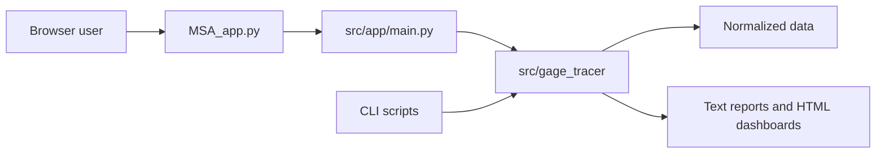

# Integrated MSA Suite

Data Tracer delivers Measurement System Analysis (MSA) workflows for Type 1 Gage Study, Paired T-Test, and crossed Gage R&R ANOVA evaluations. Each workflow supports raw input, structured data, text reports, and self-contained HTML dashboards.

[Download MSA Handy Tool (v1.0.0-beta)](https://github.com/JoseHerrera96/MSA_gage_handy_tool/releases/download/v1.0.0-beta/MSA-Handy-Tool.zip)

## Windows Portable App

Download and extract the ZIP, then open `MSA-Handy-Tool.exe`. Keep the
`_internal` folder alongside the executable. The beta targets Windows 10 and
11 (64-bit) and has been tested on Windows 11. It requires a compatible browser,
but does not require Python or an internet connection to run the study pages.

The app starts a loopback-only server and opens an Edge or Chrome app window;
if neither is available, it opens the default browser normally. To reopen the
window or stop the server, right-click the MSA Handy Tool notification-area
icon and choose **Abrir aplicacion** or **Cerrar servidor**. Closing the window
alone does not stop the server.

This is an unsigned experimental build, so Windows may display a security
warning. The browser workflows do not yet match every Streamlit interaction,
and validation with representative real inputs remains necessary. Stopping the
server does not delete downloaded reports or securely erase browser memory.

## Repository Overview

- `MSA_app.py` — Canonical Streamlit launcher for interactive MSA workflows.
- `cli/command.py` — Unified `msa` CLI with `type1`, `grr`, and `paired` subcommands.
- `cli/Type_1_gage_handy_tool.py`, `cli/Paired_T_Test_tool.py`,
  `cli/Gage_RR_tool.py` — Legacy entry points retained for compatibility.
- `src/app/` — Streamlit application package with its workflow views and shared components.
- `src/gage_tracer/` — Core library with parsing, calculation, and dashboard rendering.
- `data/examples/` — Versioned synthetic example inputs.
- `data/private/` — Ignored location for confidential local input data.
- `outputs/` — Ignored generated analysis files.
- `tests/` — Validation tests for key analytical components.

## Installation and CLI

For source-based workflows, install the package in editable mode from the
repository root. Python 3.10 or later is required.

```powershell
python -m pip install -e .
```

Start the Streamlit interface with `streamlit run MSA_app.py` or the installed
`msa-app` entry point. The unified `msa` CLI provides three workflows:

```powershell
msa type1 --input data/private/type1-study.txt --output outputs/type1
msa grr --input data/private/grr-study.txt --report-order operator-major --output outputs/gage_rr
msa paired --system-a data/private/system-a.txt --system-b data/private/system-b.txt --output outputs/paired
```

Streamlit processes uploaded files in memory. Active sessions retain their inputs
for analysis; after a browser disconnects, the configured reconnection window is
30 seconds. Streamlit subsequently cleans up disconnected sessions and their
uploads, but this cleanup can be delayed and is not secure memory erasure. It
does not govern hosting-provider storage, logs, backups, or downloaded reports.
CLI workflows write their results to disk.

Input and output arguments are optional; defaults use examples under
`data/examples/` and the corresponding directories under `outputs/`.

## Architecture

The project separates its interfaces, analysis logic, and entry points.
`src/gage_tracer/` contains the reusable core; `src/app/` and `cli/` coordinate
the web interface and file-based workflows.



### Application and analysis modules

- `MSA_app.py` launches Streamlit and imports `main` from `src/app`.
- `src/app/main.py` coordinates navigation and the three study views;
  `components/`, `theme.py`, and `assets/styles.css` provide shared UI pieces.
- `data_parser.py` parses and validates the input formats for each study.
- `calculations.py` implements Type 1 and crossed Gage R&R calculations,
  including bias, capability indices, variance components, and NDC.
- `paired_ttest.py` aligns paired observations and computes tests, intervals,
  diagnostics, and multi-characteristic results with Holm adjustment.
- `visualization.py` and `paired_visualization.py` generate study dashboards.
- `presentation.py` prepares tables, previews, and presentation states;
  `study_config.py` holds shared study configuration and thresholds.
- `cli/app.py` launches the packaged Streamlit application; `cli/command.py`
  exposes the unified command-line interface.

The analysis flow is **raw input → parsing and validation → calculations →
presentation or export**. The user interfaces delegate calculations to the core.

### Command-line entry points

The unified `msa` interface accepts explicit input and output paths:

```powershell
msa type1 [--input FILE] [--output DIR]
msa grr [--input FILE] [--output DIR] [--report-order part-major|operator-major]
msa paired [--system-a FILE] [--system-b FILE] [--output DIR]
```

The legacy scripts in `cli/` remain available for the Type 1, Paired T, and
Gage R&R workflows. They share the `src/gage_tracer/` implementation rather
than maintaining separate statistical formulas.

## Repository Standard

Examples are versioned under `data/examples/`; confidential local inputs belong
in the ignored `data/private/` directory. Generated data, reports, and
dashboards belong under `outputs/` and are ignored by Git. Do not place
production measurement data in version control.

## Layout

```text
.
├── LICENSE
├── README.md
├── requirements.txt
├── MSA_app.py
├── cli/
│   ├── command.py
│   ├── __main__.py
│   └── legacy workflow entry points
├── data/
│   ├── examples/
│   └── private/
├── docs/
├── outputs/
├── src/
│   ├── app/
│   └── gage_tracer/
└── tests/
```

## Getting Started

### Interactive UI

Launch the Streamlit application:

```bash
streamlit run MSA_app.py
```

or with the selected Python interpreter:

```bash
python -m streamlit run MSA_app.py
```

The UI provides:
- Dark-themed MSA workflow selection
- In-memory file upload support
- Live metric panels
- Exportable HTML dashboards

### Input Examples

In Streamlit, **View example** shows a synthetic example for the selected study
and report format. Download the selected text file or, for Paired T and grouped
Gage R&R, the complete ZIP. Gage R&R examples match the selected file distribution
and, for a single file, the selected report sequence. The preview shows the first
24 lines; the download contains the complete data. For customized examples,
enter `REPORT` in both marker fields.

Ready-to-upload examples in `data/examples/input_modes/` use the same
measurements across formats. Select the corresponding option in Streamlit:

| Study | BEGIN/END markers | Periodic reports without markers | Customized |
| --- | --- | --- | --- |
| Type 1 | [blocks.txt](data/examples/input_modes/type1/blocks.txt) | [periodic.txt](data/examples/input_modes/type1/periodic.txt) | [custom.txt](data/examples/input_modes/type1/custom.txt) |
| Gage R&R | [single.txt](data/examples/input_modes/gage_rr/blocks/single.txt) | [single.txt](data/examples/input_modes/gage_rr/periodic/single.txt) | [single.txt](data/examples/input_modes/gage_rr/custom/single.txt) |

Paired T examples are also available through **View example** in Streamlit.
The generated Paired T input-mode files may be absent from a checkout; use the
generator below if those local files are needed.

For every **Customized** example, enter `REPORT` in both the Start marker and
End marker fields. Each report is enclosed by a pair of `REPORT` lines.

Gage R&R also provides `parts/part_01.txt` through `parts/part_10.txt` and
`operators/operator_1.txt` through `operators/operator_3.txt` in each of the
`blocks`, `periodic`, and `custom` directories. Select the matching upload
distribution and assign each file to the corresponding part or operator. For
`single.txt`, choose `Part → Operator → Trial`. All sets represent the same
90-report study.

Paired T additionally has `multicharacteristic_a.txt` and
`multicharacteristic_b.txt` in the `blocks` and `custom` directories. Load one
file per system. The periodic mode accepts a numeric series or tab-separated
characteristic and measurement rows per system.
The Type 1 examples contain 20 complete reports. These examples are derived
from the existing sample files and can be regenerated with:

```powershell
python data/examples/generate_input_modes.py
```

### Browser Processing Proof

Start the experimental local server with `python tests/browser_poc_server.py`:

- `http://127.0.0.1:8765/app`: unified navigation for all three studies, using
	one Pyodide instance while the page remains open.
- `http://127.0.0.1:8765/type1`: Type 1 with normalized data and HTML downloads.
- `http://127.0.0.1:8765/grr`: Gage R&R with single or grouped inputs and HTML/ZIP reports.
- `http://127.0.0.1:8765/paired`: Paired T with two inputs and HTML/ZIP reports.
- `http://127.0.0.1:8765/`: the original synthetic comparison proof.

Each study supports the three report formats and provides synthetic examples;
use `REPORT` in both custom marker fields for those examples. Switching studies
asks before clearing selected inputs and results. In characteristic views, Gage
R&R can show its report chart and normalized observations, while Paired T can
show its summary, diagnostics and report card inline on demand. Complete HTML
dashboards remain available as downloads. The browser views do not reproduce
every Streamlit interaction. These prototypes do not replace the production UI.

By default the pages load Pyodide 0.27.7 from jsDelivr, which can observe the
connection and IP address. To serve the three study pages locally, obtain the
[official Pyodide 0.27.7 full distribution](https://github.com/pyodide/pyodide/releases/tag/0.27.7),
verify the archive checksum published there, extract it outside the repository,
and point the server to the extracted directory containing `pyodide-lock.json`:

```powershell
python tests/browser_poc_server.py --pyodide-dir "C:\path\to\pyodide"
```

The server checks required package files against the supplied lock file, but
does not independently authenticate the lock or Pyodide core files. Obtain them
from a trusted source. The original `/` proof still uses jsDelivr even with a
local runtime; local-only mode applies to `/app`, `/type1`, `/grr`, and `/paired`.

To run the optional browser comparison tests, install Playwright in the local
development environment (`python -m pip install playwright`), then run:

```powershell
python tests/browser_type1_check.py --pyodide-dir "C:\path\to\pyodide" --include-other-studies
```

On Windows this uses installed Chrome and Edge by default; `--browser PATH` can
be repeated to choose executables. To compare a Type 1 file selected by you,
add `--input PATH --format blocks`, or choose `periodic` or `custom`; custom
inputs also need `--start-marker` and `--end-marker`. Without `--input`, tests
use synthetic data. They compare numerical results with absolute tolerance
`1e-8` and relative tolerance `1e-6`, verify actual downloads, and block
non-local page requests. `--include-other-studies` also checks unified
navigation, one-time runtime loading, result cleanup, and chart previews.
Downloaded test files are deleted afterward, without a secure-erasure guarantee.

The study pages read selected files and run calculations in browser memory; they
are not designed to send filenames or measurements to the server. In local-mode
synthetic tests, page requests were limited to allowlisted localhost assets.
This does not protect against a compromised browser or runtime, guarantee secure
deletion, or establish equivalence for every input. Python and browser runtimes
use different library versions and can render charts or line endings differently.
The server binds to localhost and exposes only allowlisted project source files.

### Building the Windows Distribution

Before sharing or publishing a build, review the third-party terms in
`desktop/THIRD_PARTY_NOTICES.md` and the bundled package licenses.

To rebuild on Windows, install `pyinstaller==6.22.3` and `pystray==0.19.5` in the development
environment and obtain the official Pyodide 0.27.7 core archive and the required
scientific packages from the [release](https://github.com/pyodide/pyodide/releases/tag/0.27.7).
To use the system UCRT included in Windows 10 and later, run:

```powershell
python desktop/build.py --core-archive "C:\path\to\pyodide-core-0.27.7.tar.bz2" --packages-dir "C:\path\to\pyodide-packages" --system-ucrt
```

The build checks the official core archive's SHA-256, checks each required
package against the lock file from that archive, and verifies the Visual C++
runtime DLLs against the official redistributable. An alternative SDK-based
build accepts `--ucrt-dir` and `--sdk-license`; see the third-party notices for
its conditions. It refuses to overwrite an
existing `dist/MSA-Handy-Tool`; choose a different `--output` directory for
another build. To test the packaged executable locally with synthetic data,
install the optional Playwright development package and run:

```powershell
python tests/check_desktop_executable.py dist/MSA-Handy-Tool/MSA-Handy-Tool.exe
```

Add `--verify-tray-source` to test loading a modified copy of the bundled
pystray source. This test makes changes only to a temporary copy of the bundle.
The build includes notices and a version manifest under `_internal`, but a
complete licensing review remains necessary before redistribution.
The exact desktop and browser source used for the build is included in
`_internal/source/application-source.zip`; it is not the full repository.

The full unittest suite currently reports a missing Paired T example file in
`test_paired_input_mode_examples_are_equivalent`; the desktop and browser
synthetic checks do not require that file. No real measurement files are used
by those checks.

### CLI Workflows

#### Type 1 Gage Study
The Type 1 subcommand defaults to the bundled example. Supply custom files and
output directories with:

```bash
msa type1 --input data/private/type1-study.txt --output outputs/type1
```

In Streamlit, the Type 1 workflow offers three input layouts. The existing layout
uses one file with complete `BEGIN`/`END` report blocks. The delimiter-free
layout uses one file with consecutive reports and no required markers. Each
measurement row must be tab-separated as
`<characteristic><TAB><measurement><TAB><nominal><TAB><upper tolerance><TAB><lower tolerance>`;
extra trailing columns are ignored. Headers and `PATTERN:`, `DISPLAY:`, or
`UNIT:` metadata may appear between reports. Each report must contain the same
characteristics in the same order; a repeated characteristic starts the next
report. The app displays the number of complete cycles detected and rejects
incomplete or inconsistent cycles. The bundled `data/examples/type1/RAW DATA.txt`
contains 120 complete reports followed by a truncated report; the parser rejects
that final incomplete report rather than silently dropping or completing it.

The Type 1 workflow also offers **Customized** report separation. Enter start and
end markers that each occupy their own line; matching is case-insensitive after
trimming whitespace. Use the same marker in both fields when one delimiter
alternates between opening and closing reports; it must occur an even number of
times. Text outside marked reports is ignored, while malformed or incomplete
reports inside markers are rejected.

#### Paired T-Test
For a paired comparison, specify both files:

```bash
msa paired --system-a data/private/system-a.txt --system-b data/private/system-b.txt --output outputs/paired
```

#### Gage R&R (Crossed)

Supply the raw report file and optional report order:

```bash
msa grr --input data/private/grr-study.txt --output outputs/gage_rr
```

The input must form a balanced design:

$$\text{reports} = \text{operators} \times \text{parts} \times \text{trials}$$

Each characteristic in a report receives an independent Gage R&R analysis and its own report/dashboard pair.

For untagged report blocks, the order of the 90 reports determines the Part,
Operator, and Trial labels. The default is `part-major`
(`Part → Operator → Trial`); select `operator-major`
(`Operator → Part → Trial`) when that matches the collection sequence:

```bash
msa grr --input data/private/grr-study.txt --report-order operator-major --output outputs/gage_rr
```

The Streamlit workflow provides the same sequence choice. Part-tagged single-dimension input derives the part from its tags. It also asks **How are the reports separated?** and offers **BEGIN/END markers**, **Periodic reports without markers**, or **Customized** for each upload distribution (one file, one per part, or one per operator). In periodic mode, rows retain the characteristic, measurement, nominal, upper-tolerance, and lower-tolerance columns; repeating the first characteristic begins the next report. Customized markers must each occupy their own line; use the same marker in both fields to alternate report boundaries. Text outside marked reports is ignored, and malformed or incomplete report blocks are rejected.

Streamlit also supports grouped uploads while keeping the same crossed design:

- **10 files, one per part:** 9 reports per file; 3 trials for each of the 3 operators.
- **3 files, one per operator:** 30 reports per file; 3 trials for each of the 10 parts.

Characteristic tags are not fixed across source files. They may be names such as
`Measurement1`–`Measurement3` or feature codes; each report must contain a
consistent characteristic set. The parser assigns Part, Operator, and Trial
from the selected upload mode and report order. The bundled
`data/examples/gage_rr/GAGE RR DATA_backup.txt` is not a complete study: it contains only
42 reports with duplicate `Measurement` tags and is rejected by validation.

After processing, the Gage R&R workflow opens with a study overview that summarizes the verdict, variation components, NDC, and interaction result for every characteristic. Download the overview on its own or as the first HTML file in the all-reports ZIP.

For the Paired T-Test, default inputs come from `data/examples/paired/`.
Single-characteristic files contain one finite number per
nonblank line. Multi-characteristic files use matching `:BEGIN`/`:END` blocks;
within each block, each row is `<characteristic><TAB><measurement>`, with
optional trailing GRR metadata fields ignored. Optional `PATTERN:`, `DISPLAY:`,
and `UNIT:` lines are allowed inside blocks. Both systems need at least two
blocks, the same block count and characteristic labels, and corresponding
observations in the same block order. Multi-characteristic studies open with an
overview and can export it with the per-characteristic dashboards.
Characteristic labels can vary by source; corresponding blocks in System A
and System B must use the same labels in the same order. A leading UTF-8 BOM
is accepted in numeric files. The bundled OGP pair has 10 blocks and 8
characteristics per system, with matching tags and within-block order.

In Streamlit, **Periodic reports without markers** accepts either one finite
measurement per line or tab-separated `<characteristic><TAB><measurement>`
rows. A tabular row may also include nominal, upper tolerance and lower
tolerance columns; these and other trailing columns are ignored and are not
used to evaluate conformity. Every report must repeat the same characteristic
labels in the same order, and both systems must have matching report counts
and characteristic order. Repeating the first characteristic begins the next
report. Numeric-only characteristic labels are rejected in this mode because
they are ambiguous with multiple numeric measurements. Text-only headers and
footers, `PATTERN:`, `DISPLAY:`, `UNIT:`, and `BEGIN`/`END` markers are
ignored. Unclassified text between measurements and ambiguous or non-finite
measurements are rejected. The paired-observation preview includes original
source line numbers.

The paired workflow also offers **Customized** separation for either one numeric
measurement per report or tab-separated characteristic/measurement rows. Enter
whole-line start and end markers for both system files; the marker pairs and
characteristic order must match. A single repeated delimiter can be entered in
both fields and must occur an even number of times. Text outside marked reports
is ignored; source line columns continue to refer to the original files.

## License

The application is distributed under the [MIT License](LICENSE). See
`desktop/THIRD_PARTY_NOTICES.md` and the bundled licenses for third-party terms.

