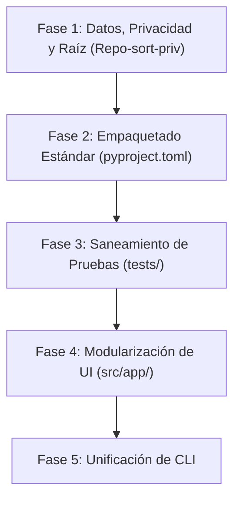

# Plan de Acción: Modernización y Reorganización Arquitectónica

> **Rama activa:** `Repo-sort-priv`  
> **Objetivo:** Alinear el repositorio con los estándares contemporáneos de arquitectura de software en Python (Clean Architecture, PEP 517/621, SoC y gobernanza de datos privados) sin romper la funcionalidad analítica ni la interfaz de usuario.

---

## 1. Visión General del Plan

El plan se estructura en **5 fases incrementales**. Cada fase es autónoma y concluye con validaciones ejecutables para garantizar que la aplicación web y los cálculos estadísticos nunca se degraden durante la transición.

---

## 2. Detalle de Fases de Ejecución

### Fase 1: Datos, Privacidad y Limpieza de Raíz (Prioridad Inmediata)
**Objetivo:** Resolver la saturación de la raíz eliminando las carpetas pseudo-módulo (`gage_rr`, `gage_type1`, `paired_ttest`) y estableciendo una frontera clara entre código, datos de ejemplo, datos privados y documentación.

* **1.1. Creación de la estructura de datos unificada:**
  * `data/examples/`: Reubicar los archivos `.txt` de muestra (`RAW DATA.txt`, `GAGE RR DATA.txt`, `OGP DATA _A.txt`, `PAIRED DATA SYSTEM A/B.txt`) y plantillas (`.xlsx`).
  * `data/private/`: Directorio dedicado para datos industriales confidenciales del usuario, explícitamente ignorado en `.gitignore`.
  * `outputs/`: Carpeta centralizada para salidas generadas (`data/`, `reports/`, `dashboards/`), con subdirectorios y regla en `.gitignore` para no subir archivos generados.
* **1.2. Reubicación de documentación y activos de referencia:**
  * Mover las capturas PNG de Minitab y el PDF de referencia de `paired_ttest/docs/` y `gage_rr/templates/` hacia `docs/references/`.
  * Reubicar especificaciones UI/UX (`1_resumen_ejecutivo_ui_ux.md`, `2_especificaci_n_t_cnica_css.md`) en `docs/specifications/`.
* **1.3. Eliminación de artefactos huérfanos:**
  * Remover o reubicar el archivo `Gage_Study_Summary_dashboard.html` (784 KB) que quedó residual en la raíz.
  * Eliminar las carpetas vacías `gage_rr`, `gage_type1`, `paired_ttest` de la raíz.
* **1.4. Actualización de rutas en scripts CLI:**
  * Ajustar las constantes de ruta en `cli/*.py` para apuntar a `data/examples/` y `outputs/` con compatibilidad retroactiva.
* **Criterio de Aceptación:**
  * Raíz limpia sin carpetas de datos ni archivos HTML sueltos.
  * `.gitignore` actualizado protegiendo `data/private/` y `outputs/`.
  * Pruebas de dominio (`test_modular_domain.py`) pasan al 100%.

---

### Fase 2: Empaquetado Formal Estándar (PEP 517 / PEP 621)
**Objetivo:** Convertir el repositorio en un paquete Python instalable estándar, eliminando la necesidad de modificar `sys.path` en tiempo de ejecución.

* **2.1. Creación de `pyproject.toml`:**
  * Declarar metadatos del proyecto, versión, autores y licencia.
  * Declarar dependencias formales (`dependencies`) basadas en `requirements.txt`.
  * Configurar `setuptools` o `hatchling` con `package-dir = {"": "src"}`.
  * Declarar puntos de entrada de comando (`[project.scripts]`) para Streamlit y CLI.
* **2.2. Instalación editable:**
  * Soporte formal para `pip install -e .` en el entorno `.venv`.
* **2.3. Limpieza de hacks de importación:**
  * Retirar de forma progresiva las líneas `sys.path.insert(0, ...)` en los puntos de entrada principales.
* **Criterio de Aceptación:**
  * `pip install -e .` instala el paquete sin advertencias.
  * El paquete `gage_tracer` es importable desde cualquier directorio de trabajo.

---

### Fase 3: Saneamiento y Aislamiento de la Suite de Pruebas (`tests/`)
**Objetivo:** Lograr una suite de pruebas profesional, autónoma y ejecutable sin dependencias del sistema de archivos local.

* **3.1. Limpieza de scripts obsoletos:**
  * Eliminar o migrar `tests/test_calculations.py` y `tests/test_tolerances.py` (que fallan buscando archivos locales inexistentes).
  * Eliminar `tests/_runtests.py` que contiene rutas absolutas locales (`c:\Users\joseh\...`).
* **3.2. Centralización de fixtures de prueba:**
  * Crear `tests/fixtures/` con fragmentos mínimos sintéticos necesarios para pruebas de regresión.
* **3.3. Configuración del runner de pruebas:**
  * Garantizar que `python -m unittest discover -s tests` ejecute y apruebe todas las pruebas sin scripts satélite.
* **Criterio de Aceptación:**
  * `python -m unittest discover -s tests -p "test_*.py"` finaliza en código 0 sin errores ni omisiones.

---

### Fase 4: Modularización de la Aplicación Web (`src/app.py`)
**Objetivo:** Descomponer el archivo monolítico de más de 1,300 líneas en una arquitectura por vistas desacopladas y componentes reutilizables.

* **4.1. Extracción de estilos y tokens:**
  * Extraer las reglas CSS y Design Tokens afinados en la sesión previa hacia `src/assets/styles.css` (o inyección centralizada en módulo `theme.py`).
* **4.2. División por capas de presentación:**
  * `src/app/components/`: Componentes transversales (`sidebar.py`, `file_pills.py`, `alerts.py`).
  * `src/app/views/`: Vistas independientes de cada flujo de trabajo:
    * `type1_view.py`: Lógica de UI para Type 1 Gage Study.
    * `paired_view.py`: Lógica de UI para Paired T-Test (overview, reportes individuales).
    * `grr_view.py`: Lógica de UI para Gage R&R Crossed (1 archivo, 10 piezas, 3 operadores).
  * `src/app/main.py`: Orquestador principal ligero (<100 líneas).
* **Criterio de Aceptación:**
  * La interfaz visual mantiene exactamente la estética y comportamiento validados en el rediseño.
  * Cada vista puede modificarse de forma aislada sin afectar a las otras dos.

---

### Fase 5: Unificación de la Interfaz CLI
**Objetivo:** Reemplazar los scripts aislados en `cli/` por una herramienta de línea de comandos profesional con subcomandos.

* **5.1. CLI basada en subcomandos (`msa`):**
  * Subcomandos unificados:
    * `msa type1 --input <file> [--output <dir>]`
    * `msa grr --input <file> [--report-order <part-major|operator-major>]`
    * `msa paired --system-a <file> --system-b <file>`
* **5.2. Desacoplamiento de convenciones rígidas de archivo:**
  * Parámetros explícitos con valores por defecto hacia `data/examples/` y `outputs/`.
* **Criterio de Aceptación:**
  * Los flujos analíticos pueden ejecutarse desde terminal mediante un único comando coherente.

---

## 3. Matriz de Riesgos y Mitigación

| Riesgo | Impacto | Estrategia de Mitigación |
| :--- | :---: | :--- |
| **Ruptura de rutas en CLI existente** | Medio | Mantener alias o fallbacks temporales en `cli/` hacia las nuevas ubicaciones en `data/examples/`. |
| **Fuga involuntaria de datos industriales** | Alto | Crear `data/private/` e incluirlo en `.gitignore` antes de mover cualquier archivo de producción. |
| **Regresión en pruebas durante modularización de app.py** | Bajo | Validar `compileall` y la suite de pruebas unitarias al final de cada commit. |

---

## 4. Orden de Ejecución Recomendado

1. **Paso 1:** Ejecutar **Fase 1** en esta rama `Repo-sort-priv` (reorganización física de carpetas y privacidad).
2. **Paso 2:** Incorporar **Fase 2** (`pyproject.toml`) para formalizar el paquete.
3. **Paso 3:** Proceder con **Fase 3** (limpieza de `tests/`).
4. **Paso 4:** Modularizar la UI (**Fase 4**) y el CLI (**Fase 5**).
